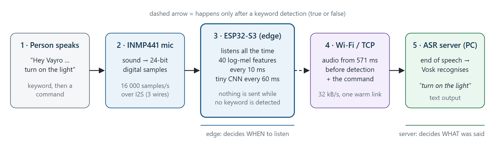
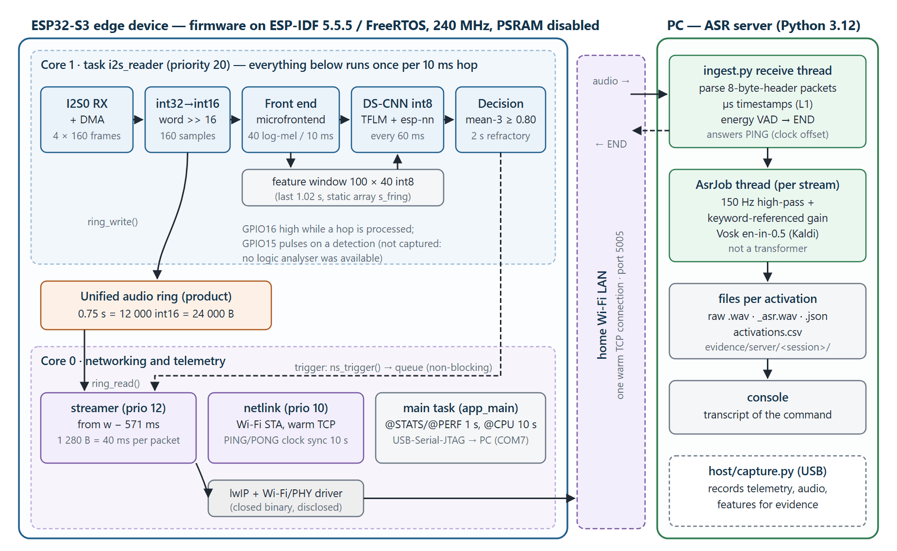
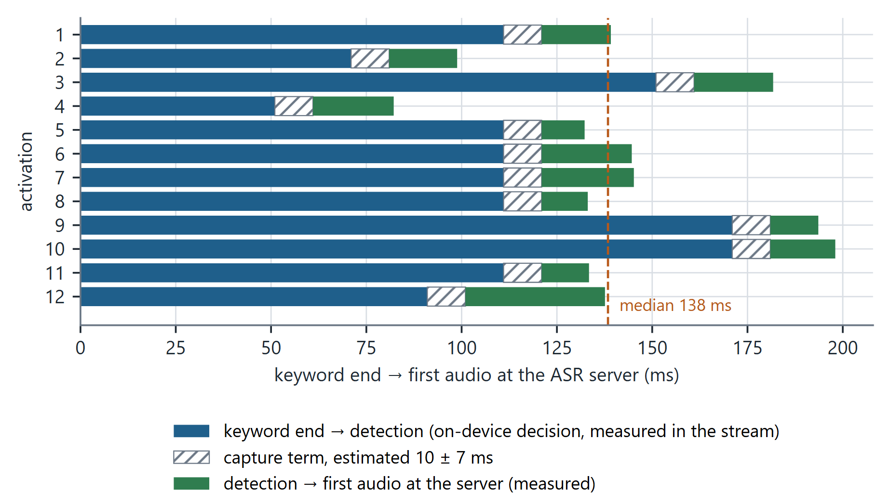
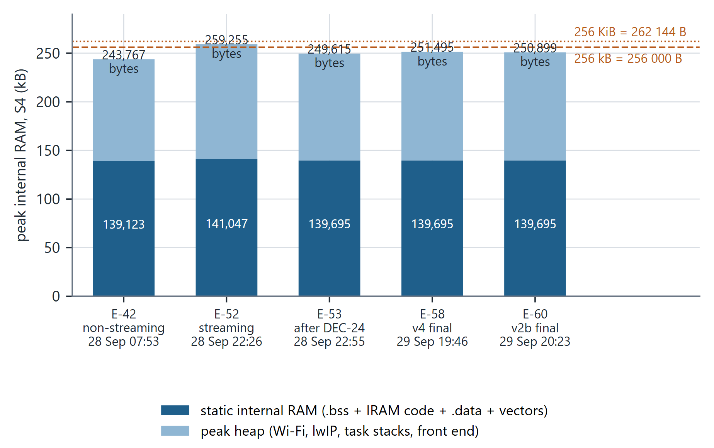
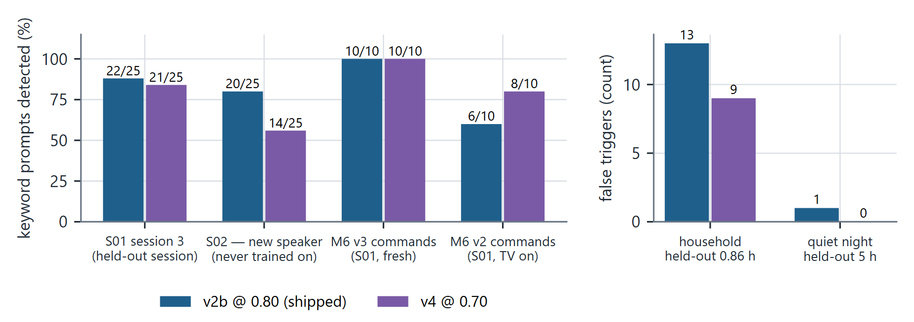

# Hey Vayro — a low-latency edge voice activator on an ESP32-S3

[](https://github.com/Kartikinfinity/vayro-edge-voice-activator/actions/workflows/ci.yml)
[](LICENSE)


A microcontroller listens all the time for one custom phrase, **"Hey Vayro"**, and sends nothing anywhere while it waits.
When it hears the phrase it streams the audio that follows, starting 571 ms *before* the detection so nothing is cut off,
to a server that turns the spoken command into text.

Built for **Smart India Hackathon 2026, problem statement 26172** (ISRO): *Low Latency and Efficient Voice Activator for
Edge Devices*. Team DATA_Edgepulse.



## What is in the box

| Part | What it does | Where |
|---|---|---|
| Edge firmware | INMP441 microphone over I2S, 40-band log-mel features every 10 ms, a 10 665-parameter int8 DS-CNN every 60 ms, decision logic, 0.75 s audio ring, Wi-Fi/TCP streaming | [`firmware/`](firmware) |
| Keyword model | trained from random initialisation on synthetic and real "Hey Vayro" speech; 28 KB int8 TensorFlow Lite Micro model | [`model/`](model) |
| ASR server | receives streams, timestamps them, ends them when the speaker stops, recognises the command with Vosk (Kaldi) | [`server/`](server) |
| Host tools | record audio and telemetry from the device over USB, run scripted test sessions, analyse results | [`host/`](host) |
| Evidence | every measurement quoted below, with its raw logs | [`evidence/`](evidence), [`docs/EVIDENCE_LEDGER.md`](docs/EVIDENCE_LEDGER.md) |

## Measured results

All numbers are from the physical prototype (one ESP32-S3 board, one INMP441) running the final firmware with model `v2b`.
Each links to a ledger entry that names its raw files.

| Requirement in the problem statement | Result | Evidence |
|---|---|---|
| RAM under 256 KB | **245.0 KiB** (250 899 B) peak while streaming, counting code in RAM, all stacks and the Wi-Fi/TCP buffers, with PSRAM disabled | E-60 |
| Idle CPU under 10 % | **9.3 %** on the busiest core, **5.5 %** averaged over both cores | E-56, E-60 |
| Model size | 28 024 B int8, 10 665 parameters, 13.4 KB tensor arena | E-24 |
| Latency: keyword end → audio at the ASR server | **138 ms** median, 196 ms at the 95th percentile (n = 12) | E-63 |
| Keyword detection | **22 / 25** on a held-out session of the training speaker, **20 / 25** on a speaker never used in training (0.5–2 m) | E-35, E-59 |
| False triggers | **0.2 per hour** in a quiet house (1 in 5 h), **15.8 per hour** with a television and conversation | E-39, E-51 |
| Open source only, custom keyword | no vendor wake-word SDK (checked on every build); model trained from scratch | E-14, E-15 |

**Known limits.** False triggers with TV or conversation are the main open problem. Only two real speakers were tested.
The per-core CPU margin is about half a percentage point, and the core reaches 10.5 % while a stream is being sent.
One 10 ms part of the latency is estimated, not measured. Power was not measured. This is a working prototype, not a
product; [`docs/report/`](docs/report/PS26172_Technical_Report.pdf) chapter 14 lists everything that is unfinished.

## How it works



1. **Capture.** The INMP441 delivers 24-bit samples at 16 kHz over I2S. The firmware keeps the top 16 bits and writes
   every 10 ms block into a 0.75 s ring buffer.
2. **Features.** TensorFlow Lite Micro's microfrontend turns a 30 ms window into 40 log-mel values (125–6 500 Hz) with
   noise reduction and per-channel gain control. The same C sources are compiled for the PC, so training features are
   bit-identical to the device's (12 000 / 12 000 frames checked).
3. **Model.** Every 60 ms a depthwise-separable CNN scores the last 1.02 s of features. Weights stay in flash.
4. **Decision.** A detection needs the mean of three consecutive scores to reach 0.80, and at least 2 s since the last one.
5. **Stream.** On a detection the device sends the ring's last 571 ms and then live audio over a TCP connection that was
   opened at boot, in 40 ms packets with an 8-byte header. If it ever falls behind it says so and stops, instead of
   sending damaged audio.
6. **Server.** A Python server timestamps every packet, measures the clock offset to the device, ends the stream after
   0.7 s of quiet, and transcribes the command with Vosk in a separate thread.

All always-on work runs in one task on core 1; networking runs on core 0.

<details>
<summary>Latency, memory and model-choice evidence (charts generated from the raw logs)</summary>







</details>

## Repository layout

```text
firmware/     ESP-IDF 5.5.5 project: main/app_main.c and components (audio_capture, audio_ring,
              microfrontend, kws_engine, netstream, serial_link, instrument)
model/        frontend.json (single definition of the features), host twin of the front end,
              dataset builder, training, int8 export, device-identical evaluation, trained models v0–v4
server/       ingest.py (TCP ingest, endpointing, ASR) and measurement scripts (latency, stream integrity, replay)
host/         capture.py (USB recorder), scripted recording protocols, analysis
tools/        build wrapper, code generators, the forbidden-dependency gate, integrity checks
docs/         technical report, evidence ledger, project state and decisions, SBOM, submission deck
evidence/     raw logs and results of every run (recordings withheld, see evidence/README.md)
```

## Getting started

### Hardware

| INMP441 pin | ESP32-S3 pin | Signal |
|---|---|---|
| SCK | GPIO6 | bit clock, 1.024 MHz |
| WS | GPIO5 | word select, 16 kHz |
| SD | GPIO4 | serial data |
| L/R | GND | selects the left slot |
| VDD / GND | 3V3 / GND | supply |

The pins are set in [`firmware/sdkconfig.board`](firmware/sdkconfig.board). The project used an ESP32-S3 with 16 MB flash and
8 MB PSRAM; PSRAM is disabled in the firmware and 4 MB of flash is enough. On this board the microphone data is aligned
with MSB-justified I2S framing, not the usual Philips framing; the firmware's boot log prints an alignment check for
both.

### Firmware (Windows, ESP-IDF v5.5.5)

```powershell
# 1. host tools environment (the build wrapper uses it for its checks)
py -3.12 -m venv .venv-host
.venv-host\Scripts\pip install -r host\requirements.txt

# 2. network settings: copy the example and edit the three values
copy firmware\sdkconfig.wifi.example firmware\sdkconfig.wifi

# 3. build and flash the product configuration (COM7 = the board's USB port)
powershell -ExecutionPolicy Bypass -File tools\idf.ps1 -Console usbjtag -Port COM7 `
    -ExtraDefaults "$PWD\firmware\sdkconfig.product" -BuildTag product build flash
```

`tools/idf.ps1` expects ESP-IDF v5.5.5 in `D:\esp\esp-idf-v5.5.5`; set `PS26172_IDF_PATH` and `PS26172_IDF_TOOLS_PATH`
to use another location. ESP-IDF does not build from a path that contains spaces. Omit `-ExtraDefaults … -BuildTag product`
for the capture build, which also sends audio, features and model scores over USB for recording and replay.

### ASR server

Download and unpack [`vosk-model-en-in-0.5`](https://alphacephei.com/vosk/models) (about 1 GB), then:

```powershell
.venv-host\Scripts\python -u server\ingest.py --port 5005 --asr <path to vosk-model-en-in-0.5> --min-after-s 0.8 --stream-s-max 6
```

### Device console and recording

```powershell
.venv-host\Scripts\python host\capture.py --port COM7 --wall-s 600 --label my_run
```

The firmware waits up to 30 s at boot for this tool to open the USB port, then starts on its own. Say "Hey Vayro" and a
command: the console prints a `@KW` line, the server prints the transcript.

### Training a model

The training pipeline runs in Linux (WSL Ubuntu was used): `tools/setup_train_env.sh`, `tools/get_piper_voices.sh`,
`model/frontend/build_twin.sh`, then `model/data/gen_tts.py`, `model/data/build_dataset.py`, `model/train/train.py`,
`model/train/export.py` and `tools/gen_model_source.py`. The scripts contain absolute paths of the original set-up
(`/mnt/d/ps26172`) that you will need to adjust. Rebuilding a dataset also needs room audio and keyword recordings made
through your own device, because the project's recordings are not published; the trained models `v0`–`v4` and all their
metrics are in [`model/artifacts/`](model/artifacts).

## Documentation

| Document | Contents |
|---|---|
| [Technical report (PDF, 104 pages)](docs/report/PS26172_Technical_Report.pdf) | the full reconstruction: research basis, hardware, code walkthrough, every test including the failures, results, limitations, glossary |
| [Evidence ledger](docs/EVIDENCE_LEDGER.md) | 63 entries, each with its claim, method, measured value, limits and raw-file path |
| [Project state and decisions](docs/PROJECT_STATE.md) | requirements, the 26 recorded engineering decisions, conflicts found, milestone status |
| [Software bill of materials](docs/SBOM.md) | every component, version and licence, with the disclosures |
| [Idea submission deck](docs/submission/PS26172_SIH2026_Idea.pdf) and its [claims audit](docs/submission/EVIDENCE_CONSISTENCY_SHEET.md) | the six-slide submission and the check of each claim against the evidence |

## How the numbers can be trusted

- **Device equals replay.** Device features and model outputs are bit-identical to the PC's, and live detections equal
  an offline replay of the same audio (27/27, 39/39 and 12/12 trigger times). Models can therefore be compared on hours
  of recorded audio exactly as the device would have behaved.
- **Rules before results.** Data splits and model-selection rules were committed before the data they judge existed
  (`model/artifacts/selection_rule_v*.json`). The one time a rule was overridden, after the first new-speaker test, it is
  recorded as an override (`selection_final.json`).
- **Strict readings.** RAM includes instruction code held in RAM, every task stack and the network buffers. Latency
  starts at the acoustic end of the keyword, not at the detection. False triggers are reported per condition with the
  hours observed.
- **Failures are kept.** The ledger and the report include the failed and corrected results, such as the first product
  build at 260 KiB, three stream overruns caused by the server, and a model that passed its rule and then failed on a new
  speaker.

Continuous integration runs three checks without any toolchain: the forbidden-dependency gate, `tools/ci_checks.py`
(the front-end hash, the embedded model bytes and the compiled-in operating point must match their sources), and a
compile of all Python sources.

## About this public copy

The development repository holds recordings that are not published: voice clips of the speakers, household audio,
videos, and feature dumps derived from room audio. In the logs, the home network's name and the last three bytes of
hardware addresses are redacted. Everything else, including all logs, result files and models, is here.
[`evidence/README.md`](evidence/README.md) lists what was withheld and how the history was produced. Commit ids cited in
the evidence refer to the development history; each public commit carries an `Original-commit:` line, so
`git log --grep <id>` finds it.

## Licence and third-party components

The project's own code and the trained model are licensed under [Apache-2.0](LICENSE); see [NOTICE](NOTICE).

- The keyword pipeline (front end, model, runtime, kernels, training code) is open source. The only closed code in the
  firmware is Espressif's Wi-Fi/PHY radio driver and the chip's boot ROM, as disclosed in the SBOM.
- Two of the four synthetic voices used for training are built on datasets licensed for non-commercial use. Commercial use
  needs a retrain without them, which is a configuration change in `model/data/gen_tts.py`.
- Vendored: the TensorFlow Lite Micro microfrontend (Apache-2.0) and KissFFT (BSD-3-Clause), unmodified, with provenance in
  [`firmware/components/microfrontend/PROVENANCE.md`](firmware/components/microfrontend/PROVENANCE.md).

## Acknowledgements

TensorFlow Lite Micro and esp-tflite-micro, Espressif's esp-nn kernels and ESP-IDF, KissFFT, Vosk and Kaldi, Piper TTS and
its voices, and LibriSpeech. The model family follows Zhang et al., "Hello Edge: Keyword Spotting on Microcontrollers"
(arXiv:1711.07128).
